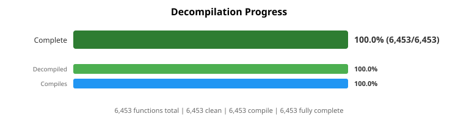
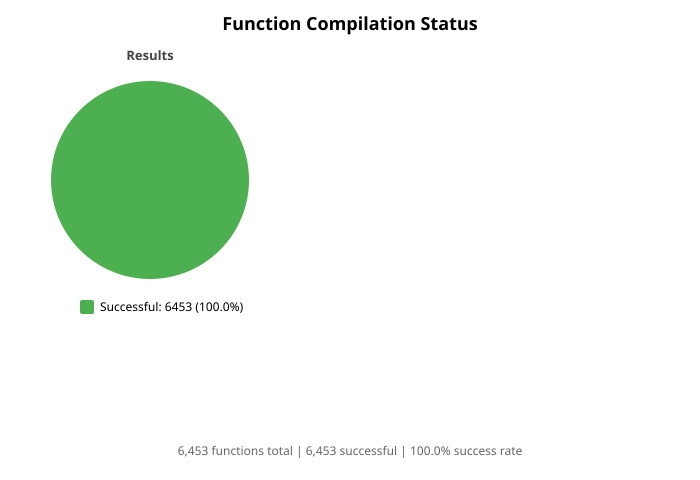
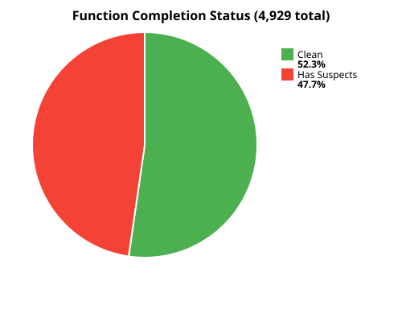
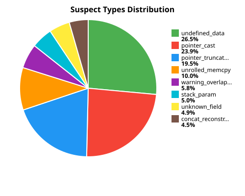
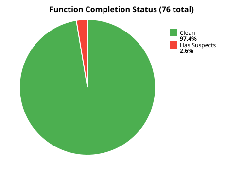
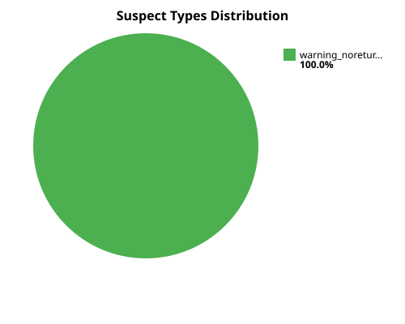
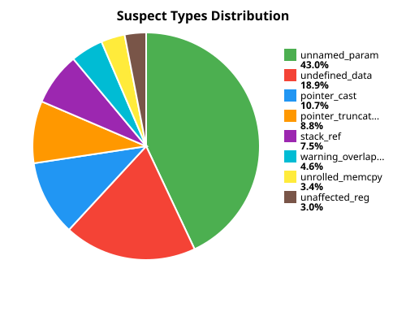
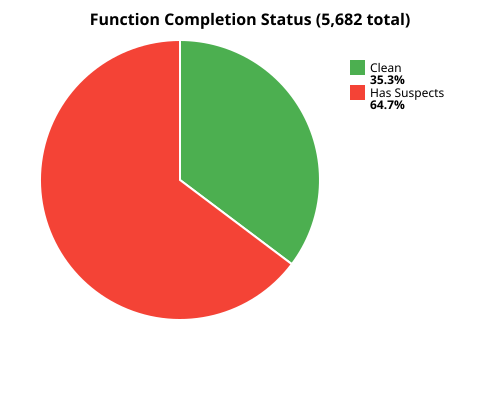
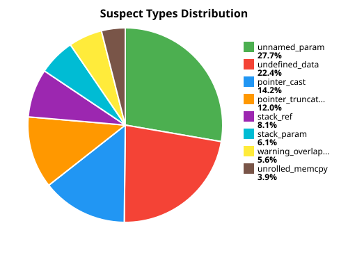
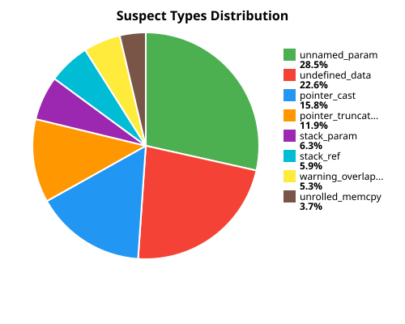

# Progress

The charts are regenerated by the annotation export, one set per binary in the Ghidra project.

- **Clean** means the function's decompilation has no suspect patterns (`extraout_`, `unaff_`,
  `BADSPACEBASE` and the rest of [decompiler-artifacts.md](decompiler-artifacts.md)).
- **Complete** means clean *and* it compiles with clang++.
- Only `nocedit.exe` is compiled, because it is the build that runs. The other binaries are
  analysed for their signatures, names and types, so only their decompilation charts are shown.

Click a chart for its per-file breakdown. The recreation's progress is tracked separately, in
the [recreation itinerary](recreation-itinerary.md).

## nocedit.exe

The editor build of Nocturne, and the one the playable decompilation is made from.

| Decompilation | Suspects |
|:---:|:---:|
|  |  |

## nocturne.exe

The retail game build. Its names and signatures are transferred from `nocedit.exe`; the
function bodies are not finished. See [sibling-binaries.md](sibling-binaries.md).

| Decompilation | Suspects |
|:---:|:---:|
|  |  |

## tridx7.dll

The hardware 3D renderer. The build uses its own `trigl` renderer in its place, and this
annotation is the reference for it. See [research/11](../research/11-tridx7_3d_renderer_dll/).

| Decompilation | Suspects |
|:---:|:---:|
|  |  |

## Blair Witch Volume 1: Rustin Parr (bw1.exe)

The three Blair Witch games run on the Nocturne engine. They are mapped against `nocedit.exe`
to find what the engine shares and what each game added. See [mod-support.md](mod-support.md).

| Decompilation | Suspects |
|:---:|:---:|
|  |  |

## Blair Witch Volume 2: The Legend of Coffin Rock (blairwitch2.exe)

| Decompilation | Suspects |
|:---:|:---:|
|  |  |

## Blair Witch Volume 3: The Elly Kedward Tale (bw3.exe)

| Decompilation | Suspects |
|:---:|:---:|
|  |  |
