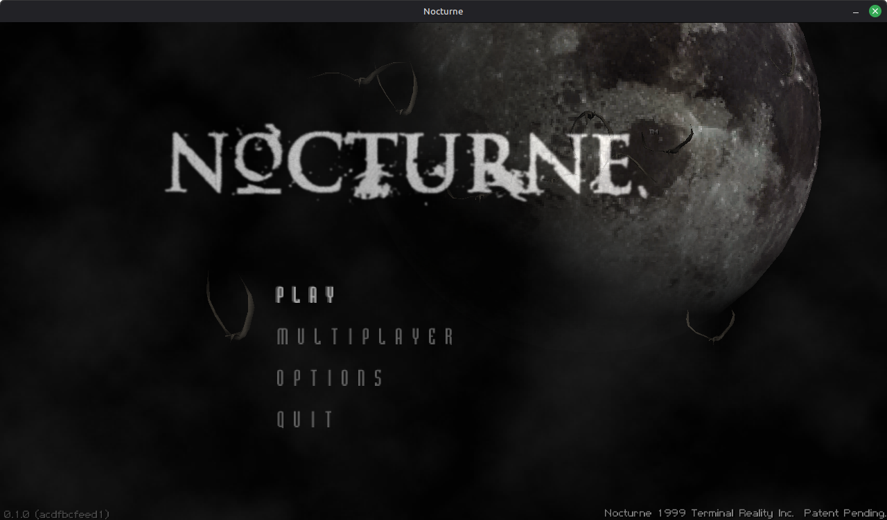
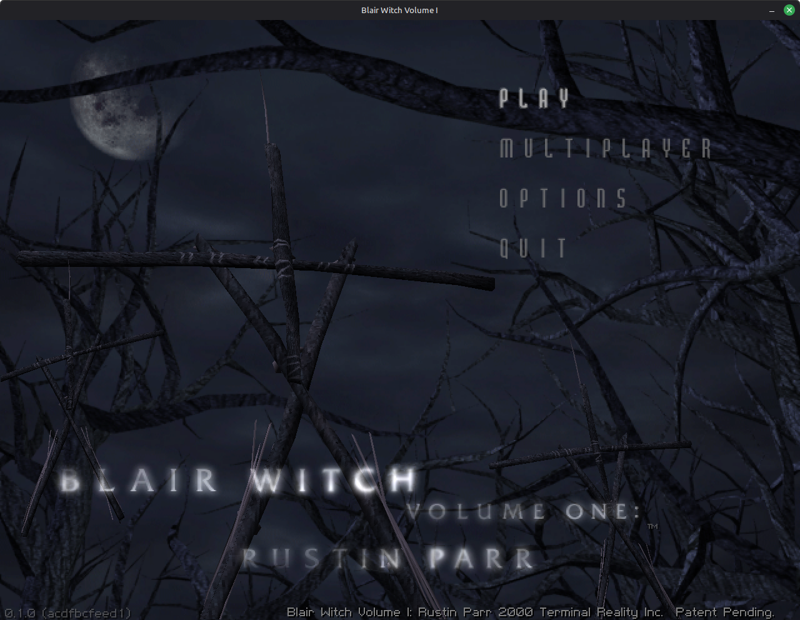
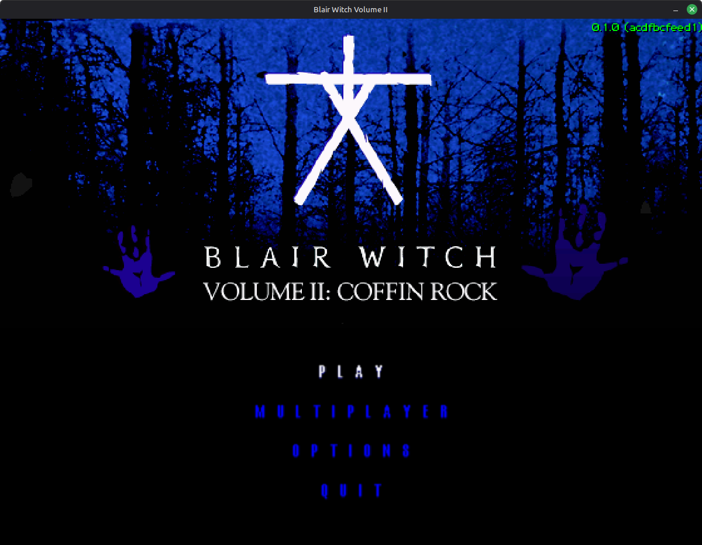
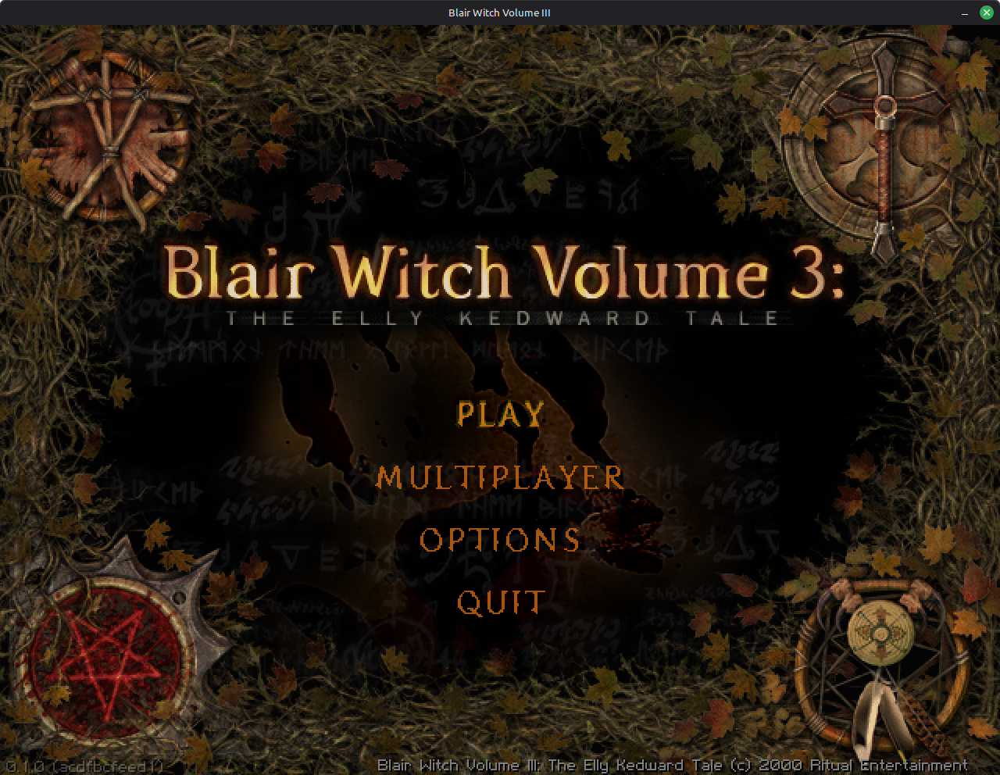

# Screenshots

Screenshots of the project's two source trees: the decompilation, which plays the original
game, and the [recreation](../docs/recreation-itinerary.md), the clean C++ engine built from it.
[About](../docs/about.md) explains the difference.

## The recreation

The recreation isn't playable yet. Each game runs as a [package](../docs/mod-support.md) in the
same build; what differs between them comes from the game's manifest, not from code.

### Main menus

*Nocturne. The title backdrop is the `sky_scene` style: the moon, drifting clouds and bats
flying across it.*

*Blair Witch Volume 1: Rustin Parr. The `figure_scene` style draws the stick figures in front of
a fixed camera, with the menu on the right as the manifest places it.*

*Blair Witch Volume 2: Coffin Rock. Also `figure_scene`, with its own fonts and colours, and the
build line moved to the top right.*

*Blair Witch Volume 3: The Elly Kedward Tale. The `tiled_scroll` style: a picture tiled and
scrolling, another fading in and out over it, and the border on top.*
